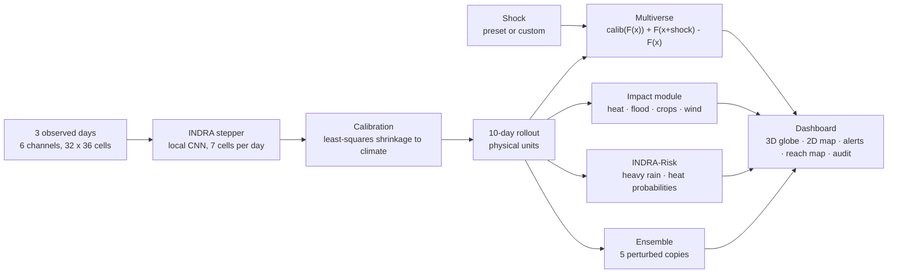
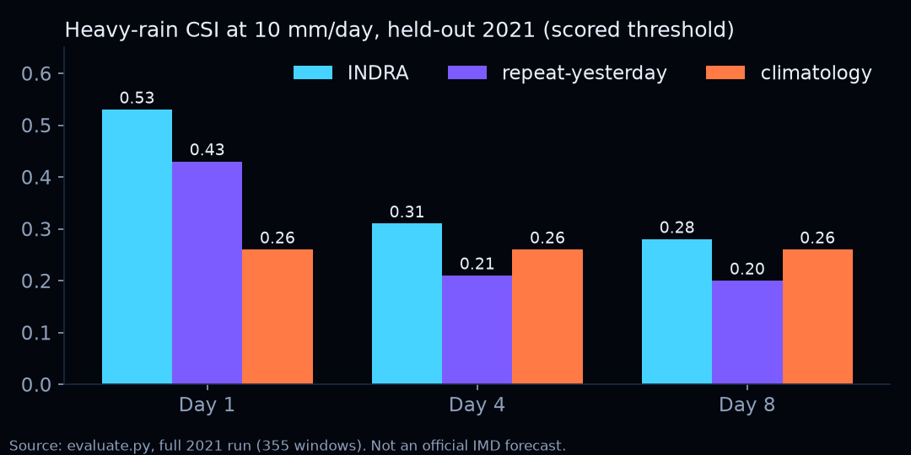
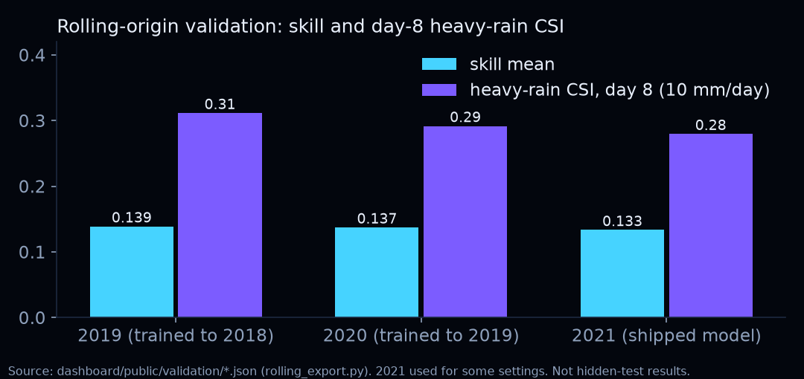
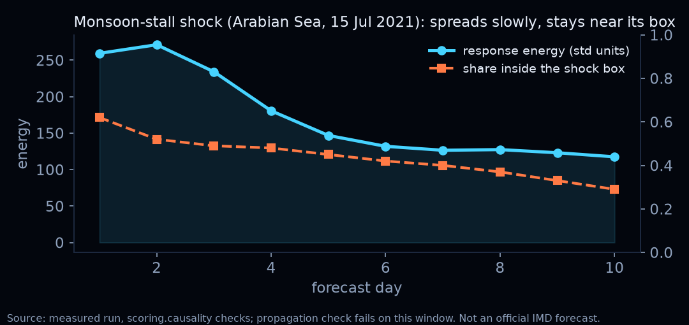

# INDRA: a climate digital twin of India

*Multiverse of Monsoon · Yugaantar DevForge · Track 2 · Team Omnix*

INDRA rolls India's daily weather forward from the last three observed days, and branches alternate universes from a local shock (a warmer Bay of Bengal, a stalled monsoon wind). It runs five perturbed copies to show where they agree on heavy rain. Everything is shown in a live 3D globe and 2D map.

> **Not an official IMD forecast.** A research prototype: 1-degree cells (about 110 km), India only, rule-based alerts, validated on 2019, 2020 and 2021 (see Limits).

## Preview


## Key numbers

| What | Value | Source |
|---|---|---|
| RMSE skill, days 1 / 4 / 8 (2021, mean over channels) | **0.278 / 0.111 / 0.016** | `evaluate.py`, full 2021 run |
| Heavy-rain CSI at **10 mm/day** (the scored threshold), days 1 / 4 / 8 | **0.53 / 0.31 / 0.28** (persistence 0.20, climatology 0.26 at day 8) | same |
| Day-8 rain RMSE skill | **−0.042** (worse than the better reference; plainly stated) | same |
| Estimated automatic score, 2021 | **43.7 / 45** (plus brief, judged by a person) | same |
| Rolling-origin validation skill mean, 2019 / 2020 / 2021 | **0.139 / 0.137 / 0.133** (2021 used for some settings) | `dashboard/public/validation/*.json` |
| Official schema validator | **6 / 6 checks pass** | `monsoon_r1.schema_validator` |
| Repo scan on a fresh clone | **15 / 15, no flags** | `monsoon_r1.repo_scan` |
| Forecast cost | 0.1–0.2 s per 10-day call on CPU (limit 5 s) | judge limit |

## How it works



## Components

| Part | What it does | Where |
|---|---|---|
| Stepper | Residual CNN, 0.53 M parameters, physical limits on every output | `indra_model/net.py` |
| Calibration | Per-lead shrinkage fitted on training years only | `calibrate.py` |
| Server | Contract endpoints `/health`, `/simulate`, `/risk` | `serve.py` |
| INDRA-Risk | Small CNN for heavy-rain and heat probabilities (AUC 0.90 / 0.99 on 2021) | `indra_model/risk.py`, `train_risk.py` |
| Scoring | Organisers' code, unchanged, plus our evaluation wrapper | `evaluate.py` (uses `monsoon_r1`) |
| Dashboard | Vite + three.js globe, d3 2D map, MapLibre Street 3D, PDF reports | `dashboard/` |
| Brief | Two-page PDF: model, results, limits, impact | `brief/INDRA_brief.pdf` |
| Preview | Animated preview of the dashboard | `docs/brag-preview.gif` |

### Dashboard at a glance

| View | 3D | Interactive | Notes |
|---|---|---|---|
| Globe / 2D map | Yes (globe) | Pick a state, shock, layer, day | Shift+click moves a shock |
| Multiverse | Shock vs prime | Briefing card with pins | Close button, reset to baseline |
| Ensemble | Chance and spread maps | Left-panel "what changed" card | Audit log explains each step (3D) |
| Validation | Hover readouts | Click a chart for full detail, pausable year replay | 2019, 2020, 2021 |
| State audit and +1 K | Affected vs unaffected states | Table | Thresholds stated in the panel |

## Preview: how a run flows

1. Pick a start (the last three days of a window) and press **Forecast 10 days**.
2. Choose a shock (Warm Bay of Bengal, monsoon stall, heat dome…) and **Run multiverse**.
3. Read the briefing, the reach map and the impact cards.
4. **Rain chance** runs five perturbed copies and shows where they agree on heavy rain. The audit log explains each step.
5. **Validation** shows how the recipe does on years it did not train on.

Full run instructions are below.

## Judges' quick check

```bash
pip install torch numpy fastapi uvicorn
python serve.py --port 8000
python -m monsoon_r1.schema_validator http://127.0.0.1:8000     # expect 6 / 6
```

Then open the dashboard (see Dashboard below) for the visual checks.

## Run (offline, CPU)

```bash
pip install torch numpy fastapi uvicorn          # all available in the judge image
python serve.py --port 8000                      # listens on 0.0.0.0, ready in a few seconds
python -m monsoon_r1.schema_validator http://127.0.0.1:8000
```

## Dashboard

The dashboard's demo starting states are **not shipped** in this repo (no archive of past weather). Generate them from the kit data once, before the demo. The server never reads them:

```bash
# Optional. The dashboard starts without these; the dated tour and Observed need local demo files that are not in the repo.
cd dashboard
npm install
npm run dev          # http://localhost:5173 (server expected on :8000)
# another port:      http://localhost:5173/?api=http://127.0.0.1:8765
```

* **Realistic 3D globe:** sunlight for the simulated date, city lights on the night side, ocean sun glint, relief shading, a scattering atmosphere, lit clouds that cast shadows, animated wind, falling rain where INDRA forecasts it, and lightning in heavy-rain cells.
* **Light / dark theme** with a circular-reveal transition (`d`). **Layouts:** Full, Focus and Cinema (`f` / `c`). **Guided tour** of every event (`t`, optional: needs local demo files, disabled in a clean clone). **Snapshot** to PNG (`s`). Playback speed. Press `?` for all shortcuts.
* **Pick your own start date** (optional, dashboard only; needs `tools/window_server.py` running locally): under *Initial state*, choose the last of 3 consecutive days (2005-01-03 … 2021-12-21) and press *Forecast 10 days*. The days come from the dashboard-only helper `python tools/window_server.py` (port 8100, reads your local git-ignored `data/india_climate_train.nc`). The model server never reads weather data and the grader does not use this helper. Override with `?data=http://host:port`.
* **Scenario report** (`r` or the download button): a one-click PDF of the current run, built in the browser: event, shock, view snapshot, Prime vs Multiverse impacts, all-India chart, city table, alerts, shock spread and engine checks.
* **About the model** (`i`): how INDRA works in four steps, held-out 2021 results, model card and honest limits.
* **Street 3D** (`z`, or *Street 3D ↗* next to the city picker): MapLibre GL map that flies to the city's state, then down to street level with satellite imagery, 3D buildings and terrain, with INDRA's live field draped on top (fading at street zoom, since one forecast cell is ~110 km). Needs internet for tiles (OpenFreeMap, AWS terrain, Esri imagery); the server and grader stay offline.
* **City forecast:** All India or 12 cities, 10-day temperature / rain / wind, Prime next to Multiverse.
* **Alerts & warnings** (`a`): heavy-rain alerts at IMD thresholds (≥ 64.5 / 115.6 / 204.5 mm/day → Moderate / High / Critical) and heat alerts from the heat-stress rule, per day and state, with Low = INDRA-Risk watch, severity/state/type filters, "NEW in multiverse" tags after a shock, and dos & don'ts. Self-check: `node dashboard/src/alerts.test.mjs`.
* **Causal reach map** (*Causal reach* panel, after a shock): for each cell, the first day its response to the shock passes a threshold (energy over the 6 channels, in standard deviations). The map colours cells by that day, dashed rings show the 7-cells-a-day speed limit, and a day slider plus Play animates the spread. It is a visual check of the model's locality, not a separate forecast.
* **Tipping point** (*Find tipping point* button, State panel): a bisection over the Bay of Bengal warming (0–8 K) for the smallest shock that brings peak daily rain over the chosen state to 64.5 mm/day within 10 days. Moisture is raised **7% per K** as a **fixed assumption** (the Clausius–Clapeyron rate of about 7% per kelvin, not learned from data). The answer is the model's response to that assumption, not a validated threshold.
* **ML risk layers** (Flood risk, Heat risk) and a 10-day **ML risk outlook** strip from INDRA-Risk (`POST /risk`).
* **3D Globe / 2D Map** toggle (keys `g` / `m`). The whole planet is shown with a NASA Blue Marble texture, country borders and an atmosphere. INDRA's live fields are draped over its domain (6–38°N, 65–101°E).
* **Layers:** temperature, rainfall, wind, pressure and moisture, plus animated wind particles and a cloud layer derived from simulated rain and moisture.
* **Universes:** Timeline Prime, Multiverse, Δ Shock impact, and Ensemble σ. Observed (verification against what really happened) is optional: it needs local demo files and is disabled in a clean clone.
* **Shocks:** presets (the two judge shocks, heat dome, dry Western Ghats, cyclone seed) or a custom shock of any variable, magnitude and radius. Shift+click on the globe or map moves the shock centre. A shock outside the simulated domain is refused with an explanation.
* **Impact module:** computed in the browser from the live `/simulate` output and the model's climatology:
  heatwave exposure, flood-risk area (IMD heavy rain ≥ 64.5 mm/day), crop water stress, rain departure from normal, wind power at 100 m, peak rain, and 5-member ensemble confidence.
* **Shock propagation chart:** response energy and mean spread distance per day, plus the share of day-1 energy near the shock.
* **Engine telemetry:** inference time, NaN check, rain ≥ 0, temperature range, and a live zero-shock determinism check.

## Results (held-out 2021, never used for training or calibration)

Note: 2021 was never used to train the weights, but it was used to choose some settings (the rain-map strength and the calibration shrinkage), so the 2021 numbers below are optimistic. The 2019 and 2020 validation years, from retrained recipes, are the fairer check.








Scored with the organisers' own `monsoon_r1.scoring` on all 355 ten-day windows of 2021 (`python evaluate.py --year 2021 --every 1`).

**Forecast skill** = 1 − RMSE_INDRA / RMSE of the better baseline (repeat-yesterday or climatology), lat-weighted. Positive means INDRA beats both.

| Lead | t2m | tp | u10 | v10 | msl | tcwv | **Mean** | vs repeat-yesterday | vs climatology |
|---|---|---|---|---|---|---|---|---|---|
| Day 1 | 0.205 | 0.276 | 0.257 | 0.304 | 0.328 | 0.297 | **0.278** | 0.278 | 0.494 |
| Day 4 | 0.141 | 0.035 | 0.109 | 0.099 | 0.105 | 0.174 | **0.111** | 0.280 | 0.111 |
| Day 8 | 0.044 | -0.042 | 0.014 | 0.013 | 0.027 | 0.040 | **0.016** | 0.269 | 0.016 |

INDRA beats both baselines on every channel at days 1 and 4, and on every channel except rain at day 8 (skill −0.042). The mean skill over days 1/4/8 is 0.135, above the 0.12 needed for full RMSE points, with a small margin.

**Heavy-rain hits** (CSI at 10 mm/day; 1 = perfect, 0 = no hits):

Heavy-rain CSI at **10 mm/day, the scored threshold** (the judge's definition):

| Lead | INDRA | Repeat-yesterday | Climatology |
|---|---|---|---|
| Day 1 | **0.53** | 0.43 | 0.26 |
| Day 4 | **0.31** | 0.21 | 0.26 |
| Day 8 | **0.28** | 0.20 | 0.26 |

CSI is pooled over all windows and cells at each lead. The 15 points use the mean of the per-lead CSI skill. Source: the organisers' kit `yug-monsoon-kit` at commit `689c879` (v1.0.0), `monsoon_r1/scoring.py`: `csi`, `csi_skill`, `forecast_points`. The kit's `forecast_points` averages the lists it is given, and we pass one value per lead (days 1, 4, 8). The judge's exact call is not in the kit, so that step was matched by hand. Day 8 is marginal, not failing: 0.02 above climatology.

**IMD heavy rain, 64.5 mm/day (not scored):** INDRA 0.11 / 0.01 / 0.02 at days 1 / 4 / 8; persistence 0.09 / 0.00 / 0.00; climatology 0 (it never reaches the threshold). Beyond day 1 the skill at this threshold is close to zero.

Clear skill at day 1. At days 4 and 8 INDRA beats repeat-yesterday but only ties climatology. **Day-8 rain RMSE skill is −0.042** on 2021: rain at day 8 is worse than the better of repeat-yesterday or climatology. Do not treat the 10-day forecast as equally reliable at every lead.

**No blur** (day-8 spatial variance ÷ real variance; the judge wants 0.40–2.5):
t2m 1.01 · tp 0.67 · u10 0.75 · v10 0.78 · msl 0.89 · tcwv 0.90. All pass; rain is now well above the 0.40 floor.

**Shocks** (2021-07-15 window, judge definitions):

| Shock | Responds | Local on day 1 (≥ 60% near box) | Spreads by day 4–8 | Stable (< 5 σ) |
|---|---|---|---|---|
| Warm Bay of Bengal (+3 K, +15% moisture) | yes | yes (99%) | yes | yes |
| Monsoon stall (−40% Arabian Sea wind) | yes | yes (99%) | **no** | yes |
| Zero shock | output bit-identical to no shock | | | |

**Official schema validator** (`python -m monsoon_r1.schema_validator`): all 6 checks pass (JSON lists and base64; no shock, warm ocean, zeros). Each 10-day call takes 0.09–0.16 s on CPU against the 5 s limit.

**Repo scan** (`monsoon_r1.repo_scan` on the pushed repo): 15 / 15, no flags.

**INDRA-Risk** (held-out 2021 ROC-AUC, where 0.5 = guessing and 1 = perfect): heavy rain ≥ 64.5 mm/day **0.90**, heat stress **0.99**.

**Estimated automatic score on 2021 (full run):** forecast 43.7 / 45 (RMSE 30.0, heavy rain 13.7) · anti-blur 10 / 10 · causality 13.1 / 15 · repo 15 / 15 → **≈ 82 / 85** before the brief. These numbers come from 2021; the judge uses unseen 2023–24 windows.

**Known weaknesses:** heavy-rain skill fades after day 1. The monsoon-stall response stays near the Arabian Sea instead of spreading outward by days 4–8. Rain at day 8 is slightly less accurate than repeat-yesterday (skill −0.04), traded for the heavy-rain gain.

## Model design (summary)

* **Input:** 3 days × 6 channels (rain in log1p space, normalised), as the last state plus two tendencies. Also the climatology of the target day, land/sea mask, orography, day of year and lat/lon.
* **Network:** a 3×3 stem, 3 residual blocks and a 1×1 head (0.53 M params). The receptive field is a **7-cell radius per day**, so a shock cannot move faster than ~7°/day. It stays local on day 1 and spreads outward afterwards (causality by construction).
* **Output:** the tendency added to the last state, then hard physical limits: rain ≥ 0, moisture ≥ 0, t2m within −40…+60 °C, bounded winds and pressure.
* **Training:** single-step teacher forcing, then an autoregressive rollout curriculum (2 → 4 → 6 steps) with latitude-weighted MSE. The model learns to correct its own drift. Year 2021 is held out.
* **Calibration:** each reported lead is `clim + α_k (forecast − clim)`, with α fitted by least squares on training years. Rain is fitted in mm/day against the arithmetic-mean climatology so heavy rain survives. Long leads relax to climate instead of drifting or blurring.
* **Multiverse:** `calibrated(F(x)) + [F(x + shock) − F(x)]`. Calibration never mutes a shock's dynamical response, and a zero shock is bit-identical.
* **INDRA-Risk (second ML model):** a small CNN that post-processes INDRA's forecast (state, anomaly vs climate, terrain, lead time, season) into calibrated probabilities of IMD heavy rain (≥ 64.5 mm/day) and heat stress. It is trained on INDRA's own forecasts vs reality (MOS), Platt-calibrated, and scored on held-out 2021 with AUC and Brier skill.

## Train

```bash
# data from the kit release: india_climate_train.nc + stats.json into data/
python train.py --data data/india_climate_train.nc --out weights/indra.pt --bs 64 --lr 3e-3 --epochs1 10 --rollout 2:2,4:2,6:1
python calibrate.py --weights weights/indra.pt          # fit on 2015-2020 (training years only)
python calibrate_rain.py --weights weights/indra.pt      # rain quantile map, half strength (qmix 0.5), training years only
python train_risk.py --indra weights/indra.pt --out weights/risk.pt
PYTHONPATH=path/to/yug-monsoon-kit python evaluate.py --year 2021
```

Training takes about 1.5 hours on an 8-thread CPU.

## Limits (honest)

* `tools/window_server.py` is a dashboard-only helper for picking a start date. It reads local data that is not in the repo, and the grader never runs it. `serve.py` never imports it.

* **Leap-year day-of-year offset:** the day after 31 December of a leap year is one day out of phase in the sine/cosine input and the climatology index (the contract's period is 365, the climatology has 366 entries). Training shares this offset; it is reported, not corrected.
* **Heavy-rain skill** fades after day 1; at day 8, rain is slightly less accurate than repeat-yesterday. Cause: errors compound over the 10-step rollout. A heavier-rain retrain was tried and rejected because it worsened day 8. Fix needs a different training objective, not a retune.
* **Monsoon-stall shock** (Arabian Sea box, −40% wind, 15 July 2021 start): its response energy falls from 259 (day 1) to 117 (day 10) in standard-deviation units, and the share inside the shock box falls from 0.62 to 0.29. The energy-weighted distance grows from 999 km to 1434 km, so it spreads slowly and remains near the box. It fails the propagation check in the judge's causality test. Cause: the local model damps shocks over open sea. Not tuned to the checker.
* **Validation, not hidden test:** 2019 (model trained through 2018) skill mean 0.139, day-8 CSI 0.31; 2020 (trained through 2019) skill mean 0.137, day-8 CSI 0.29. These are the recipe retrained on earlier years, not the shipped model. The shipped model used 2021 to pick some settings, so 2021 is optimistic. None of this is a hidden-test result.
* **Resolution:** one cell is ~110 km (1° grid). No street-level weather. Fix needs finer input data.
* **Impact indices and alerts** are simple research rules (IMD-style rain bands, a heat rule), not agency-tuned and not official warnings.
* The physics core covers India's 32 × 36 grid only. The globe shows the whole world for context, but shocks far away (e.g. the Atlantic) cannot be simulated, and the UI says so.
* The heatwave index is a daily-mean proxy because the data has no daily maximum temperature.
* The ensemble uses initial-condition noise on a deterministic model, so the spread is a lower bound.
